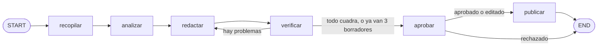

# Sesión 6 · Building a Quant Newsletter with LangGraph

Repositorio de partida del laboratorio del 21 de octubre de 2026. Es un grafo de LangGraph que escribe un brief de mercados de la zona euro con datos públicos del BCE, el Banco de España y Yahoo Finance, comprueba con Python cada número y cada cita y no lo publica sin que lo apruebe una persona. Máster en Finanzas Cuantitativas y Métodos Computacionales, Universidad de las Hespérides.

## Antes de clase: preparar

Unos 10 minutos. Hazlo antes del miércoles, no en clase.

```text
git clone https://github.com/SimplyJuanjo/hesperides-sesion-6.git
cd hesperides-sesion-6
pip install -r requirements.txt
copy .env.ejemplo .env
```

En Mac o Linux, `cp .env.ejemplo .env`. Las claves son las mismas de la sesión 5: si tienes aquel `.env`, cópialo aquí en vez de `.env.ejemplo`. Después ejecuta:

```text
python preparar.py
```

Prueba la instalación, cada clave y cada fuente de datos. Para llegar a clase hace falta «bien» en la instalación y en al menos un LLM. Si una fuente de datos falla, el brief usa su copia de `datos/copia.json`.

### Las claves

Las dos son gratis y ninguna pide tarjeta. Usa una cuenta personal: con la de la universidad, Gemini puede dar error 403.

- **Groq**, el LLM que redacta el brief (la única imprescindible): entra en [console.groq.com](https://console.groq.com) con GitHub o con tu correo, ve a «API Keys» y crea una. Va en `GROQ_API_KEY`. El modelo es `openai/gpt-oss-120b`.
- **Gemini** (opcional, muy recomendable): en [Google AI Studio](https://aistudio.google.com), «Get API key». Va en `GEMINI_API_KEY`. Si Groq llega a su límite gratuito, el brief sigue con `gemini-3.5-flash-lite` sin esperar.

## El grafo



Python recopila los datos y calcula las cifras, el LLM redacta, Python verifica cada número y cada cita y una persona aprueba. Los pasos se saben de antemano, así que es un grafo y no un agente que decide qué hacer.

## En clase

```text
pytest
```

Todo en rojo: es el punto de partida. Abre tu agente dentro de esta carpeta. Cinco peldaños, uno cada vez, cada uno con su test:

1. `analizar`, las cifras con Python: `pytest tests/test_1_analizar.py`
2. `prompt_brief`: `pytest tests/test_2_prompt.py`
3. `verificar`: `pytest tests/test_3_verificar.py`
4. `aprobar`, la pausa hasta que decides: `pytest tests/test_4_aprobar.py`
5. `ruta_tras_verificar` y `construir_grafo`: `pytest tests/test_5_grafo.py`, y después `python generar.py --dibujar` y `python generar.py`

Con todo en verde, hazlo tuyo:

- Cambia `LECTOR` en `brief.py` por alguien que conozcas.
- Añade una serie a `fuentes.py`: cualquier clave del [portal de datos del BCE](https://data.ecb.europa.eu) o un símbolo de Yahoo Finance.
- Si tu lector quiere un dato que no está, como la pendiente de la curva (10 años menos 2), añade un nodo que lo calcule con Python en vez de pedírselo al modelo.
- Saca el brief en HTML o mándalo por correo.

## Qué hay

- `brief.py`: los cinco peldaños sin hacer, el estado del grafo, el lector y los nodos que ya vienen escritos.
- `fuentes.py`: las series y los titulares, todos sin clave. `python fuentes.py` los enseña y `python fuentes.py --guardar` renueva la copia.
- `modelos.py`: la llamada al LLM, ya escrita. Si Groq no contesta y tienes clave de Gemini, sigue con Gemini.
- `datos/copia.json`: una foto de todos los datos, por si una fuente falla. La fecha va en `guardada`.
- `generar.py`: el brief completo. `--copia` usa solo la copia y `--dibujar` escribe `grafo.md` con el dibujo del grafo.
- `preparar.py`: la comprobación de antes de clase.
- `AGENTS.md`: las reglas para tu agente.
- `salida/`: los briefs publicados. No se sube a git.

## Los datos

- [Portal de datos del BCE](https://data.ecb.europa.eu): tipo de la facilidad de depósito, €STR, Euríbor a 12 meses, bonos AAA de la zona euro a 2 y 10 años, bono español a 10 años, inflación (IPCA) de la zona euro y de España y cambio dólar por euro. El BCE permite reutilizarlos citando la fuente y pide que se diga cuándo un dato es un cálculo propio: lo son los cambios que calcula `analizar`.
- Yahoo Finance: IBEX 35 y Euro Stoxx 50. No es una fuente oficial y, con la bolsa abierta, da el precio del momento, no el cierre.
- Titulares de los RSS de [prensa del BCE](https://www.ecb.europa.eu/rss/press.html) y de [noticias del Banco de España](https://www.bde.es/wbe/es/inicio/rss/rss-noticias/).

Cada cita del brief lleva al final el enlace a su fuente.

## Reglas

- Las claves van en `.env`, que no se sube a git. Nada de claves, contraseñas ni datos de tu trabajo en el código.
- A los servicios gratuitos no les mandes datos personales ni de tu trabajo.
- El brief es un ejercicio de clase, no una recomendación de inversión.
